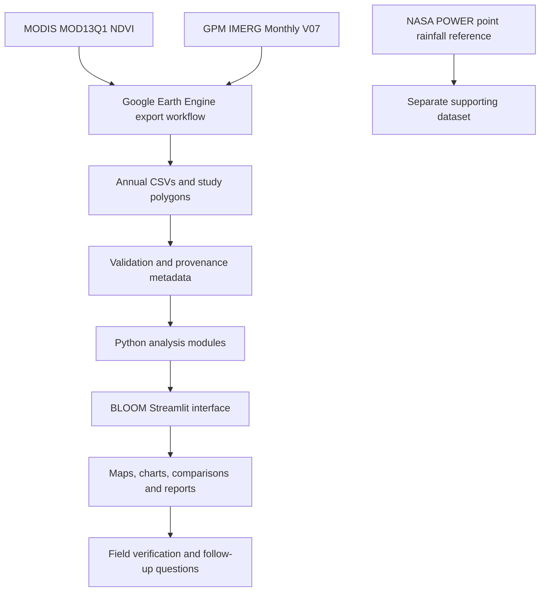

# BLOOM — Beyond the Green

**An evidence-led Earth observation platform for exploring vegetation change in Jericho, Palestine.**

BLOOM is a web-based environmental investigation prototype developed for the **NASA Space Apps Challenge 2026**. It connects geographic exploration, long-term vegetation observations, precipitation context, statistical trend analysis, and guided investigation in one accessible interface.

> **The central question:** Satellites can show that a landscape is changing. How can we investigate what that change means without claiming more than the evidence supports?

**Study location:** Jericho, Palestine  
**Study period:** 2005–2024  
**Study geography:** Two mapped polygons, `area_a` (east) and `area_b` (west)  
**Project status:** Interactive research prototype; data-file checks passed, upstream extraction provenance is still under independent review  
**Repository:** [github.com/heba-mustafa59/bloom-nasa](https://github.com/heba-mustafa59/bloom-nasa)

## Contents

1. [The challenge](#the-challenge)
2. [Our approach](#our-approach)
3. [What the prototype includes](#what-the-prototype-includes)
4. [System architecture](#system-architecture)
5. [Project structure](#project-structure)
6. [Data and documented sources](#data-and-documented-sources)
7. [Scientific methodology](#scientific-methodology)
8. [Getting started](#getting-started)
9. [Data verification and reproducibility](#data-verification-and-reproducibility)
10. [Technology stack](#technology-stack)
11. [Limitations](#limitations)
12. [Development roadmap](#development-roadmap)
13. [References and attribution](#references-and-attribution)

## The challenge

Earth observation missions measure environmental variables at different spatial and temporal scales. A variable may increase in one location and decrease in another, while a single observed pattern may have several possible explanations.

Vegetation greenness is a useful example: a change in the **Normalized Difference Vegetation Index (NDVI)** can help identify places worth investigating, but NDVI alone cannot determine whether rainfall, irrigation, harvesting, cropping decisions, or land-use changes caused the observation.

BLOOM addresses the **NASA Space Apps Earth Detective** challenge by making it easier to select environmental indicators, view change across time and space, compare study areas, and examine findings with scientific caution.

## Our approach

BLOOM is organized around a practical investigation loop:

**Explore → Analyze → Compare → Investigate → Verify → Communicate**

- **Explore:** Locate and select the two real study polygons on an interactive map.
- **Analyze:** Inspect annual NDVI and precipitation series for 2005–2024.
- **Compare:** Examine both areas on common timelines and consistent scales.
- **Investigate:** Evaluate long-term trends and cautiously screen unusual patterns.
- **Verify:** Identify the field observations and source checks needed before a conclusion or intervention.
- **Communicate:** Create transparent, downloadable investigation summaries and follow-up plans.

The goal is **decision support for further investigation**, not automated diagnosis or a claim that vegetation signals alone prove land quality.

## What the prototype includes

| Module | Purpose | Current capability |
| --- | --- | --- |
| **Home** | Introduce the environmental question | Branded project overview and investigation entry points |
| **Explore** | Connect evidence to geography | Interactive Jericho polygons, year selection, area selection and annual readings |
| **Time Machine** | Explore temporal change | 2005–2024 year navigation and consistent polygon-mean NDVI shading |
| **Analytics** | Analyze recorded environmental variables | NDVI and rainfall charts, summary metrics and trend outputs |
| **Compare** | Examine spatial differences | Area A and Area B time-series comparisons on shared periods |
| **Mystery Lab** | Test unexpected patterns | Rainfall-based exploratory NDVI model with holdout validation safeguards |
| **Area Advisor** | Compare areas by a defined question | Criterion-specific screening for annual greenness, supported greening or field-follow-up priority |
| **Action Pathway** | Translate findings into checks | Detect → Verify → Act if confirmed → Measure; conditional field checklist and monitoring plan |
| **Reports** | Make results shareable | Downloadable investigation briefs and evidence notes |
| **About** | Explain methods and constraints | Dataset descriptions, statistical methodology and caveats |

**Important:** Area Advisor does **not** score parcel suitability, predict agricultural yield, or recommend a property purchase. Field clues and checked items are user-reported, not independently verified measurements.

## System architecture



The original **Google Earth Engine JavaScript** export workflow is in [`scripts/export_nasa_data.js`](scripts/export_nasa_data.js). The application reads committed data files rather than requesting every observation from NASA when a user opens a page.

## Project structure

```text
bloom-nasa/
├── .github/
│   └── workflows/
│       └── investigation-pilot.yml       # Pilot compilation and tests
├── assets/
│   └── bloom.css                       # Web interface styling
├── data/
│   ├── ndvi_annual.csv                  # Two-area annual NDVI records
│   ├── rainfall_annual.csv              # Two-area annual precipitation records
│   ├── study_areas.geojson              # Two study polygon boundaries
│   ├── nasa_power_jericho_point_rainfall.csv
│   ├── metadata.json                    # Dataset descriptions and provenance status
│   ├── metadata_TEMPLATE.json
│   └── README.md
├── docs/
│   ├── CONTRACT.md                      # Data and module integration contracts
│   ├── NASA_DATA_PROVENANCE.md          # Verification protocol and source trail
│   ├── NASA_DATA_VALIDATION_REPORT.md   # Structural validation findings
│   ├── INVESTIGATION_PILOT_README.md    # Investigation pilot guide
│   └── TEAM_TASKS.md
├── modules/
│   ├── ui_pages/                        # Home, Explore, Analytics, Mystery, Compare,
│   │   ├── home.py                      # Reports, About and pilot experiences
│   │   ├── explore.py
│   │   ├── explore_pilot.py
│   │   ├── action_plan_pilot.py
│   │   ├── analytics.py
│   │   ├── compare.py
│   │   ├── mystery.py
│   │   ├── reports.py
│   │   └── about.py
│   ├── ui_data.py                        # Data-source selection and UI context
│   ├── ui_pilot_context.py               # Adapter for uploaded-data pilot
│   ├── ui_components.py                 # Shared layout components
│   ├── map_view.py                      # Map utilities
│   ├── dashboard.py                     # Analytics dashboard
│   ├── data_loader.py                   # Strict verified-data loader
│   ├── trend_analysis.py                # Trend estimation and significance checks
│   ├── mystery_engine.py                # Validated exploratory anomaly logic
│   ├── investigation_case.py            # Pilot data loading and investigation briefs
│   ├── discovery_time_machine.py        # Annual map-color and change logic
│   ├── area_advisor.py                  # Goal-specific area comparisons
│   ├── action_planner.py                # Conditional verification/action plans
│   └── report_generator.py              # Reserved integration interface
├── scripts/
│   ├── export_nasa_data.js              # Google Earth Engine exports
│   ├── fetch_nasa_power.py              # NASA POWER point-reference retrieval
│   └── README.md
├── tests/                                # Data, trend, model and pilot test modules
├── app.py                                # Initial foundation application
├── investigation_app.py                 # Standalone investigation pilot
├── ui_app.py                            # Main multi-page BLOOM interface
├── requirements.txt
└── README.md
```

Note: `modules/report_generator.py` currently contains a reserved interface with `NotImplementedError`; the working UI exposes its own investigation/report-preview downloads. The main application entry point for the presented experience is **`ui_app.py`**, not the initial `app.py` skeleton.

## Data and documented sources

### 1. Repository datasets — direct public links

These files are available in the public GitHub repository without signing in:

| File | Contents | Direct download |
| --- | --- | --- |
| [`data/ndvi_annual.csv`](data/ndvi_annual.csv) | Annual NDVI by study area; 40 area-year rows | [Raw CSV](https://raw.githubusercontent.com/heba-mustafa59/bloom-nasa/main/data/ndvi_annual.csv) |
| [`data/rainfall_annual.csv`](data/rainfall_annual.csv) | Annual precipitation by study area; 40 area-year rows | [Raw CSV](https://raw.githubusercontent.com/heba-mustafa59/bloom-nasa/main/data/rainfall_annual.csv) |
| [`data/study_areas.geojson`](data/study_areas.geojson) | The two Jericho-area polygons and their identifiers | [Raw GeoJSON](https://raw.githubusercontent.com/heba-mustafa59/bloom-nasa/main/data/study_areas.geojson) |
| [`data/nasa_power_jericho_point_rainfall.csv`](data/nasa_power_jericho_point_rainfall.csv) | Separate NASA POWER single-point rainfall reference | [Raw CSV](https://raw.githubusercontent.com/heba-mustafa59/bloom-nasa/main/data/nasa_power_jericho_point_rainfall.csv) |
| [`data/metadata.json`](data/metadata.json) | Source declarations, units, validation history and provenance status | [Raw JSON](https://raw.githubusercontent.com/heba-mustafa59/bloom-nasa/main/data/metadata.json) |

**Data status (15 November 2026):** The CSV structure, year coverage, identifier uniqueness and value constraints have been checked and passed. However, the exact original Earth Engine export trail and correspondence between the uploaded polygons and all source reductions have **not yet been independently reproduced or authenticated**. The authoritative repository metadata states `"verification_status": "pending"`.

These are **uploaded candidate NASA-derived study files**, not independently certified NASA observations. Their presence in GitHub does not, by itself, verify the original extraction. See the [validation report](docs/NASA_DATA_VALIDATION_REPORT.md) and [provenance protocol](docs/NASA_DATA_PROVENANCE.md).

### 2. Primary Earth observation products — official documentation

| Indicator | NASA product | Earth Engine collection ID | Native spatial scale | Official dataset link |
| --- | --- | --- | --- | --- |
| Vegetation | MODIS MOD13Q1 Collection 6.1 NDVI | `MODIS/061/MOD13Q1` | 250 m; 16-day composites | [MOD13Q1 catalog](https://developers.google.com/earth-engine/datasets/catalog/MODIS_061_MOD13Q1) |
| Rainfall | NASA GPM IMERG Monthly V07 | `NASA/GPM_L3/IMERG_MONTHLY_V07` | Approximately 11.1 km; monthly | [IMERG Monthly catalog](https://developers.google.com/earth-engine/datasets/catalog/NASA_GPM_L3_IMERG_MONTHLY_V07) |

Official identifiers and citations:

- **MODIS MOD13Q1.061:** [DOI: 10.5067/MODIS/MOD13Q1.061](https://doi.org/10.5067/MODIS/MOD13Q1.061)
- **GPM IMERG Monthly V07:** [DOI: 10.5067/GPM/IMERG/3B-MONTH/07](https://doi.org/10.5067/GPM/IMERG/3B-MONTH/07)

These catalog links document the underlying products. They do **not** authenticate the particular CSV files uploaded to this repository.

### 3. NASA APIs, Giovanni and processing tools

| Resource | Role in the project or research workflow | Reference |
| --- | --- | --- |
| **NASA POWER API** | Scripted supporting rainfall **point** reference for approximately 31.86°N, 35.45°E; not a substitute for either polygon mean | [POWER API documentation](https://power.larc.nasa.gov/docs/services/api/) and [`scripts/fetch_nasa_power.py`](scripts/fetch_nasa_power.py) |
| **NASA Open APIs** | General NASA API directory; not the source of the MODIS/GPM area exports | [api.nasa.gov](https://api.nasa.gov/) |
| **NASA Giovanni** | Supporting NASA Earth science visualization and exploratory analysis resource; no automated Giovanni ingestion is implemented in the repository | [Giovanni](https://giovanni.gsfc.nasa.gov/giovanni/) |
| **Google Earth Engine** | Geospatial dataset access, polygon reductions and export instructions | [Earth Engine](https://earthengine.google.com/) and [`scripts/export_nasa_data.js`](scripts/export_nasa_data.js) |

The separate NASA POWER reference is generated from the `IMERG_PRECTOT` parameter at a **single approximate Jericho coordinate**. It is retained for context; it is not used to manufacture missing area-specific observations.

### 4. What each data record represents

`ndvi_annual.csv` includes `year`, `area_id`, `ndvi`, and `valid_observations`. In the declared extraction script, NDVI values are scaled by `0.0001`, filtered using `SummaryQA == 0`, spatially averaged within a polygon for each usable composite, and then averaged over the year.

`rainfall_annual.csv` includes `year`, `area_id`, `rainfall_mm`, and `valid_months`. In the declared script, the monthly IMERG precipitation rate (`mm/hour`) is multiplied by the hours in that month and twelve monthly results are summed for the annual total. Years with incomplete monthly coverage are not replaced with zero.

The two polygons use the shared identifiers `area_a` and `area_b` throughout the GeoJSON, CSV data, and interface.

## Scientific methodology

### Trend analysis

- Estimate linear trend slopes, including change per decade.
- Use the Mann–Kendall test to examine evidence for monotonic change.
- Distinguish statistical significance from the mere direction of a slope.
- Treat a non-significant result as inconclusive, **not** proof of stability.

### Mystery Lab

The rainfall-only linear model is exploratory. Where sufficient paired observations exist, it trains on **2005–2018** and assesses out-of-sample performance on **2019–2024**. Anomaly flags are considered only if the model exceeds the configured validation gate: positive holdout `R²` and lower MAE than a training-mean baseline. Flagged residuals are investigation leads, not explanations of their cause.

### Area Advisor and Action Pathway

Area Advisor can answer specific questions such as which study polygon has higher recorded annual NDVI, which has a supported positive trend under the implemented criteria, or which lower-NDVI area may deserve initial field follow-up. It does **not** rank land purchases or infer agricultural suitability.

The Action Pathway supports **Detect → Verify → Act if confirmed → Measure** by generating checklists and conditional next steps. No field verification, intervention success or post-2024 outcome is implied by a user ticking a checklist.

## Getting started

### Requirements

- Python 3.11 is used in the repository's GitHub Actions test workflow.
- Git and an internet connection for dependency installation and web map tiles.
- No NASA API key is needed to read the committed CSV files in the local Streamlit pilot.

### Install

```bash
git clone https://github.com/heba-mustafa59/bloom-nasa.git
cd bloom-nasa
python -m pip install -r requirements.txt
```

### Run the main BLOOM website

```bash
python -m streamlit run ui_app.py
```

The main interface offers **Uploaded NASA CSVs (pilot)** and **Synthetic demo** modes. The pilot displays the committed uploaded study tables with the provenance warning intact. The synthetic mode contains illustrative values for testing the UI and **must not** be presented as NASA observations.

### Run the standalone investigation pilot

```bash
python -m streamlit run investigation_app.py
```

### Run tests

```bash
python -m pytest -q
```

To rerun the separate NASA POWER point-reference download, use:

```bash
python scripts/fetch_nasa_power.py
```

This does not overwrite `data/rainfall_annual.csv`.

### Reproduce the Earth Engine exports

1. Open the [Google Earth Engine Code Editor](https://code.earthengine.google.com/).
2. Prepare the two **actual** study geometries and confirm their `area_a`/`area_b` ordering. The supplied script expects a two-polygon import named `areaA`.
3. Review and run [`scripts/export_nasa_data.js`](scripts/export_nasa_data.js).
4. Execute the NDVI, precipitation and GeoJSON export tasks.
5. Save the original Earth Engine task identifiers, project, timestamps and unmodified export files.
6. Compare the exports against the committed files and complete the steps in [`docs/NASA_DATA_PROVENANCE.md`](docs/NASA_DATA_PROVENANCE.md).
7. Update `data/metadata.json` to `verified` **only after** independent source and geometry validation.

## Data verification and reproducibility

The project intentionally separates three kinds of evidence:

1. **Structural validation:** Whether a local table has valid columns, years, identifiers, quality counts and numerical ranges. This has been documented for the committed files.
2. **Source provenance:** Whether the committed rows have been matched to their original NASA/Earth Engine task outputs and exact selected polygons. This remains pending.
3. **Scientific interpretation:** Whether a trend or anomaly supports a meaningful conclusion given spatial resolution, potential confounders and model limitations. This requires careful assessment and, when relevant, independent field evidence.

The strict verified-data loader, [`modules/data_loader.py`](modules/data_loader.py), requires `metadata.json` to indicate `verified` and is expected to reject the current pending metadata. The pilot UI deliberately offers a separate, labeled path to inspect the uploaded data without silently changing that status.

## Technology stack

- **Interface:** Python, Streamlit, HTML/CSS
- **Maps:** Folium, streamlit-folium, Leaflet, OpenStreetMap and Esri imagery layers
- **Visualization:** Plotly
- **Processing:** pandas, NumPy, SciPy
- **Statistical analysis:** linear regression, Mann–Kendall testing, scikit-learn
- **Earth observation processing:** Google Earth Engine JavaScript API
- **Data formats:** CSV, GeoJSON, JSON
- **Testing and automation:** pytest, GitHub Actions

Basemap and imagery attribution must be preserved in screenshots and downstream use.

## Limitations

- The original Earth Engine task and raw-export chain of custody has not been independently confirmed for the committed area-level data.
- MODIS NDVI's approximately 250 m pixels and monthly GPM precipitation's approximately 11 km pixels have markedly different spatial scales; nearby polygons may share rainfall pixels.
- Annual NDVI polygon-mean shading in BLOOM is **not** a per-pixel NDVI satellite map.
- NDVI reflects greenness, not a complete measure of ecosystem health, yield, irrigation status or property quality.
- Annual averages can hide seasonal patterns; trends and p-values require cautious interpretation.
- Rainfall, crop cycles, irrigation, land use and other possible drivers cannot be separated causally with these indicators alone.
- The current Area Advisor is a **screening tool**, not a zoning, construction, crop suitability or financial recommendation engine.
- The existing geographic comparison covers two mapped study polygons; it is not yet a parcel-level product.

## Development roadmap

**Current prototype**

- Interactive geographic exploration and annual time navigation.
- NDVI and rainfall charts, trend analysis and area comparison.
- Exploratory anomaly screening with validation safeguards.
- Goal-specific area screening, investigation briefs and field-check planning.

**Next development phase**

- Reproduce and independently authenticate Earth Engine export provenance.
- Add additional documented study areas and richer imagery suitable for smaller extents.
- Improve source traceability, temporal resolution, map interactions and report exports.
- Introduce explainable recommendations anchored to explicit user goals and uncertainty statements.

**Longer-term vision**

Develop BLOOM into a transparent land-information assistant that can compare smaller land parcels in Jericho and additional cities. A prospective user could specify an intended use, such as agriculture or construction, and review the relevant evidence for each parcel.

Such functionality will require **new datasets and validation**, including suitably fine imagery, property boundaries, soil information, water availability, terrain, hazards, infrastructure, planning regulations and local field checks. The current NDVI and rainfall sources alone cannot determine which property is best to buy, farm or build on.

## References and attribution

1. NASA / USGS LP DAAC. **MOD13Q1.061 Terra Vegetation Indices 16-Day Global 250m.** [Earth Engine catalog](https://developers.google.com/earth-engine/datasets/catalog/MODIS_061_MOD13Q1); [DOI](https://doi.org/10.5067/MODIS/MOD13Q1.061).
2. NASA GES DISC. **GPM IMERG Final Precipitation L3 1 month V07.** [Earth Engine catalog](https://developers.google.com/earth-engine/datasets/catalog/NASA_GPM_L3_IMERG_MONTHLY_V07); [DOI](https://doi.org/10.5067/GPM/IMERG/3B-MONTH/07).
3. NASA Langley Research Center. **POWER Data Access Viewer and API.** [Documentation](https://power.larc.nasa.gov/docs/services/api/).
4. NASA GES DISC. **Giovanni Earth science data visualization and analysis.** [Giovanni](https://giovanni.gsfc.nasa.gov/giovanni/).
5. Google. **Google Earth Engine.** [Platform](https://earthengine.google.com/).
6. NASA. **Blue Marble imagery** (for optional presentation visuals, not a BLOOM study observation). [NASA collection](https://science.nasa.gov/earth/earth-observatory/collections/blue-marble/).
7. BLOOM. **Source verification and original data documentation.** [Provenance protocol](docs/NASA_DATA_PROVENANCE.md), [validation report](docs/NASA_DATA_VALIDATION_REPORT.md), [metadata](data/metadata.json).

**Project attribution:** BLOOM was developed as a team project for NASA Space Apps Challenge 2026. NASA and Google datasets and tools are credited to their respective providers; their inclusion does not imply organizational endorsement.

**Licensing note:** This repository does not currently include a top-level software `LICENSE` file. Do not infer a blanket open-source license for the original project code; review each external dataset, image and basemap's terms separately.

---

**BLOOM — Beyond the Green.**  
*See the change. Investigate the evidence. Understand the land.*
